# Documentação do Compartilha+

- [Scrum: papéis, Product Backlog, Sprints e definição de pronto](scrum/README.md)
- [Requisitos funcionais, não funcionais e regras de negócio](requisitos.md)
- Diagramas: fontes em [`diagramas/`](diagramas/) (PlantUML) e imagens em [`img/`](img/)

Para regenerar as imagens: `java -jar plantuml.jar -tpng -o ../img diagramas/*.puml`
(executado dentro de `docs/`).

| Figura do relatório | Diagrama |
|---------------------|----------|
| 3 – Casos de uso | 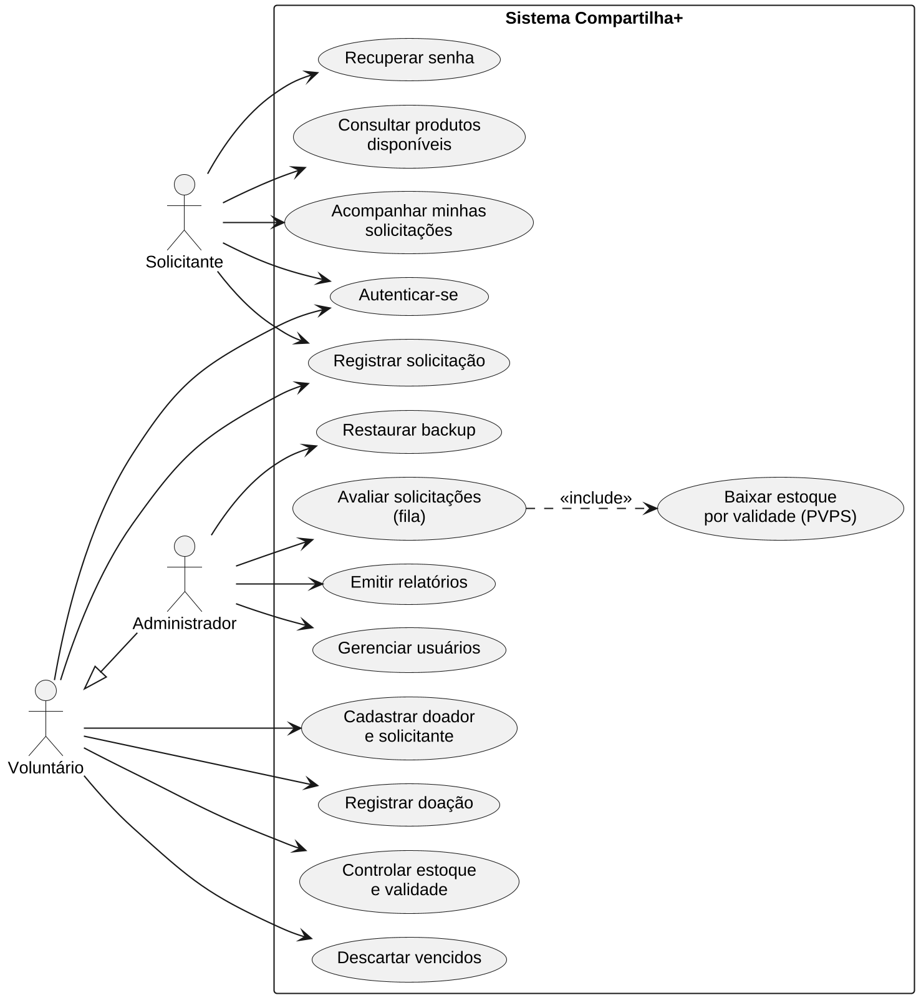 |
| 4 – Diagrama hierárquico de funções | 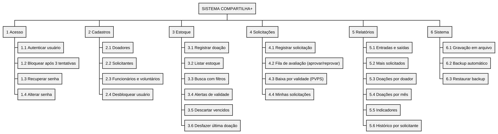 |
| 5 – Fluxograma geral | 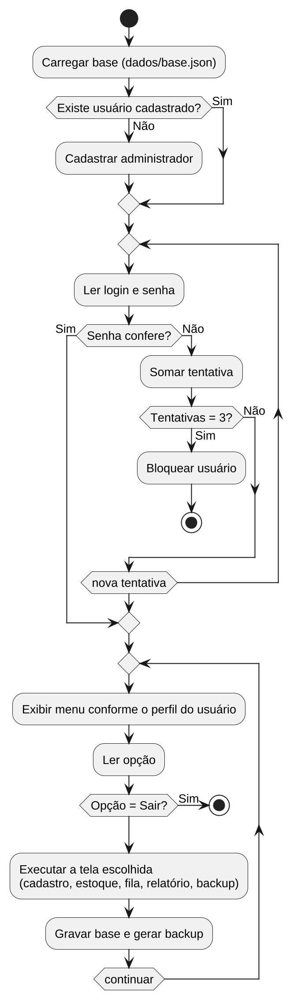 |
| 6 – Fluxograma do registro de doação | 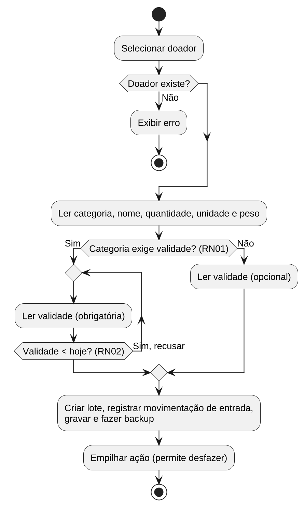 |
| 7 – Fluxograma da avaliação de solicitações | 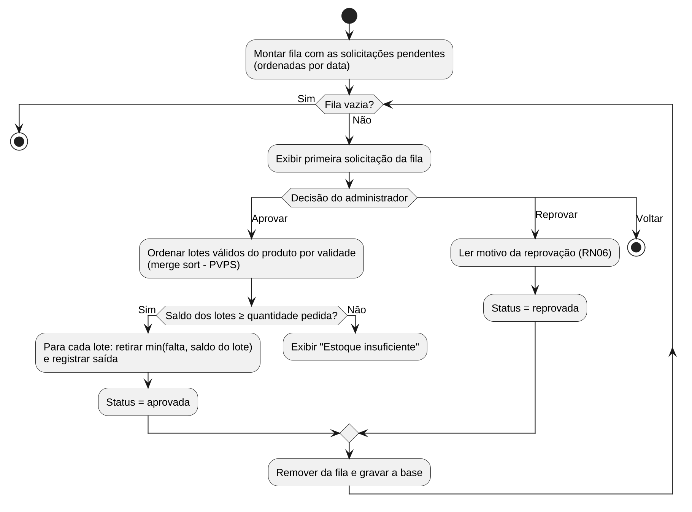 |
| 8 – Sequência do registro de doação | 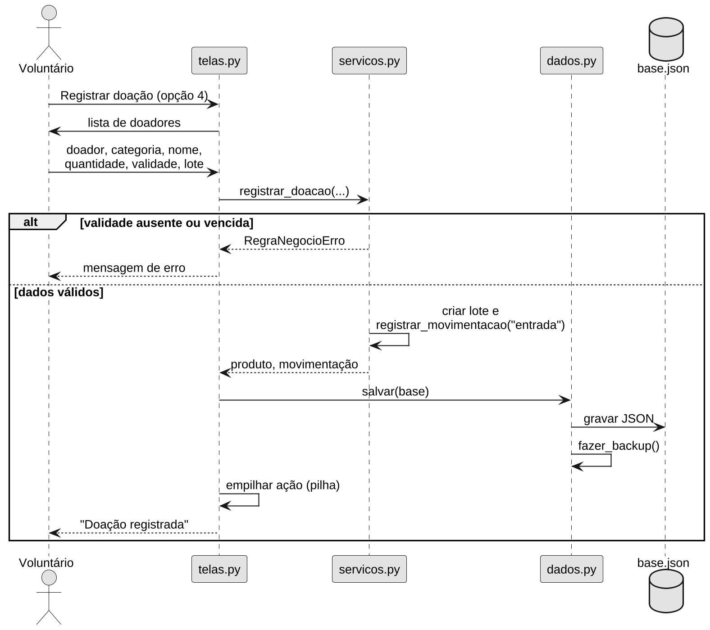 |
| 9 – Sequência da avaliação de solicitações | 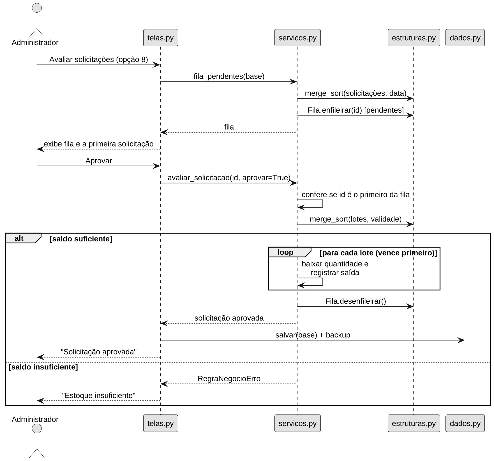 |
| 10 – Modelo de dados | 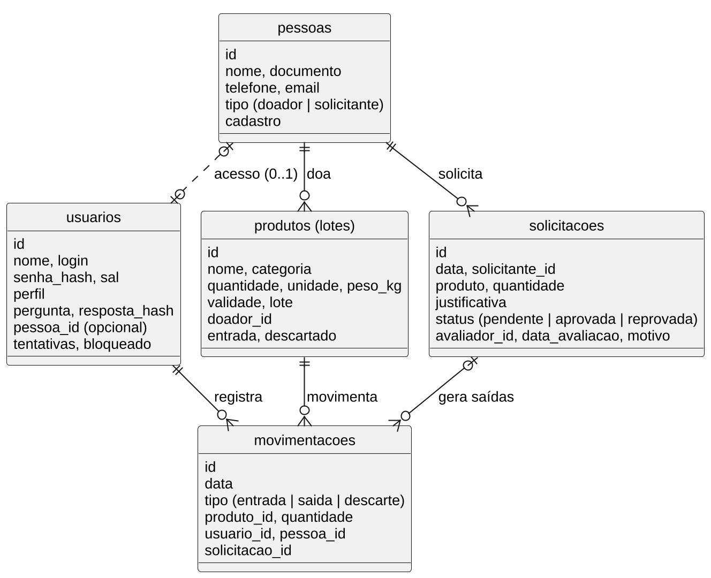 |
| 11 – Arquitetura de módulos (Python) | 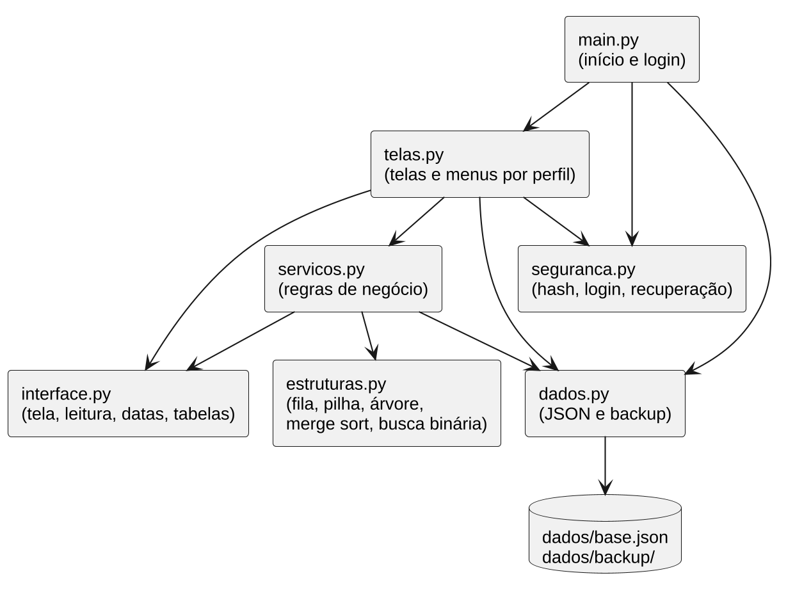 |
| 12 – Classes das estruturas de dados | 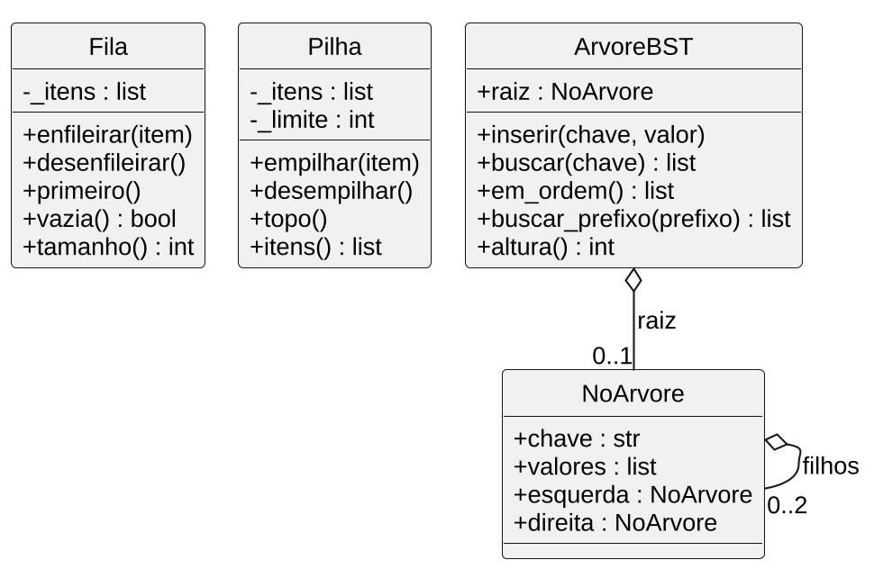 |
| 31 – Fluxograma da função `telaSaida` (C) | 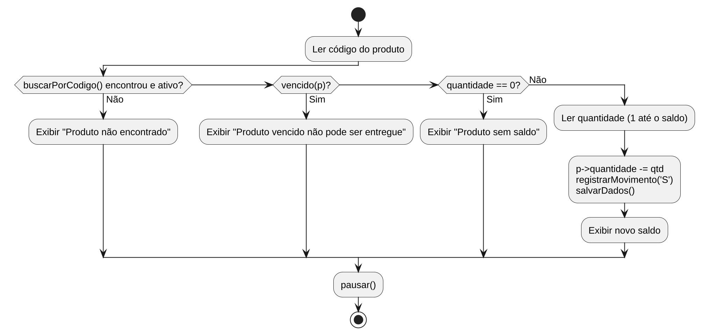 |
| 38 – Arquitetura proposta para operação em rede | 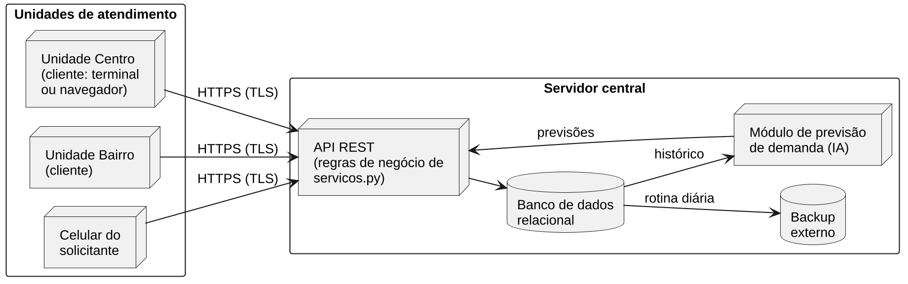 |
